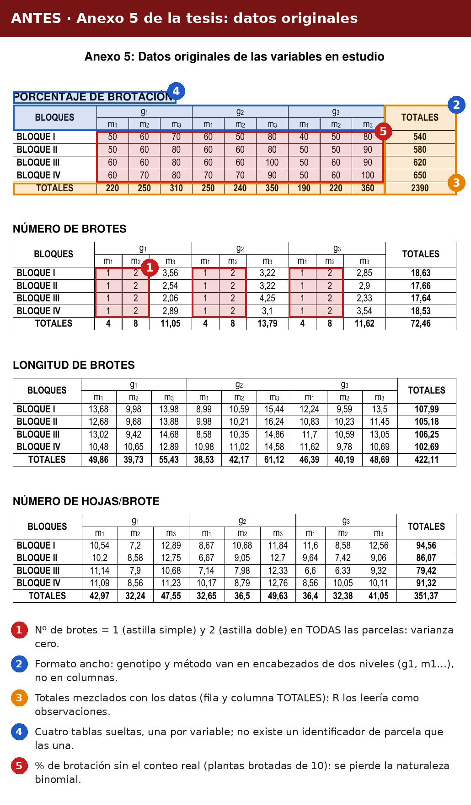
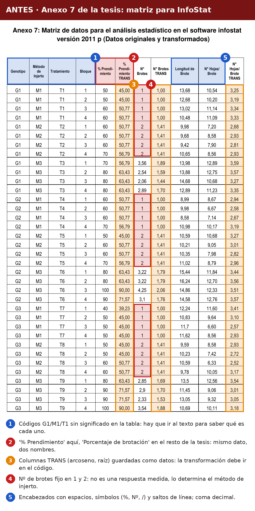
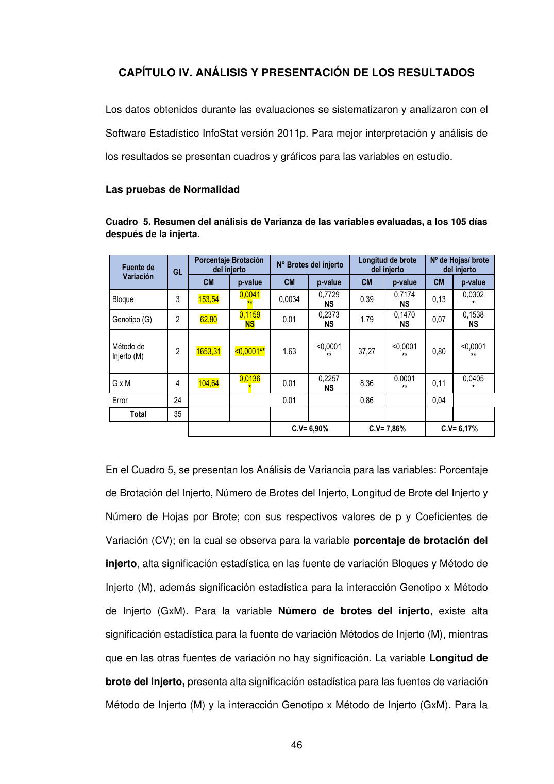

```{r}
#| label: setup
#| include: false
library(ggplot2)
library(dplyr)
library(emmeans)

azul   <- "#0B2A5B"
dorado <- "#C9A227"
gris   <- "#6B7280"
col_gen <- c("MD-014" = azul, "MD-015" = dorado, "MD-017" = gris)
```

## 1. La tesis original

::: {.resumen}
**En pocas palabras:** la tesis evaluó si el **método de injerto** (astilla simple, astilla doble o púa) y el **genotipo** de la vara yemera influyen en la brotación de injertos de camu camu. El ensayo se hizo en San Miguel (Iquitos) entre agosto de 2011 y enero de 2012, y concluyó que el **injerto por púa** fue el más eficaz.
:::

::: {layout="[30,70]"}
{.portada}

| Ficha técnica | |
|---|---|
| **Autor** | Andy Richard Reátegui Salazar |
| **Asesor** | Dr. Julio Abel Soplín Ríos |
| **Universidad** | Universidad Nacional de la Amazonía Peruana (UNAP) |
| **Año** | 2012 |
| **Lugar** | San Miguel, Iquitos (Loreto) |
| **Cultivo** | Camu camu (*Myrciaria dubia*) |
| **Diseño** | DBCA con arreglo factorial 3 × 3 |
| **Repeticiones** | 4 bloques · 36 parcelas · 360 plantas |

[📄 Ver tesis completa](https://api-repositorio.unapiquitos.edu.pe/server/api/core/bitstreams/36455bbd-36ca-40e0-aa8e-1a7fc9ed3865/content){.btn .btn-primary}
:::

### ¿Qué evaluaron?

::: {.grid}
::: {.g-col-12 .g-col-md-6}
**Factores**

- **Genotipo** (vara yemera): MD-014, MD-015, MD-017
- **Método de injerto:** astilla simple, astilla doble, púa
- Todos sobre un mismo patrón: accesión PER001155
:::

::: {.g-col-12 .g-col-md-6}
**Variables (a los 105 días)**

- Porcentaje de brotación
- Número de brotes por planta
- Longitud del brote (cm)
- Número de hojas por brote
:::
:::

### Lo que concluyó la tesis

::: {.callout-note}
## Resultados reportados por el autor
- **Púa** logró **85 % de brotación**, frente a 59 % (astilla doble) y 55 % (astilla simple).
- Púa también produjo brotes más largos (13.8 cm en promedio) y con más hojas.
- Reportó una **interacción genotipo × método** en la brotación: con púa, los tres genotipos superaron al resto.
:::

En las siguientes pestañas revisamos **cómo organizó sus datos** y **si sus conclusiones se sostienen** con un análisis adecuado.

## 2. Su base de datos

La tesis presenta los datos originales en el Anexo 5, como tablas cruzadas por variable:



Para analizarlos en InfoStat armaron otra matriz, el Anexo 7:



Si intentamos leer esa matriz en R tal como está:

```{r}
original <- read.csv("data/raw/datos_originales_tesis_anexo7.csv", sep = ";")
names(original)
str(original[, 5:9])
```

Los nombres de las columnas salen deformados y los números con coma decimal quedan como texto (`chr`), así que R no puede analizarlos directamente.

## 3. Su análisis

El autor transformó el porcentaje con arcoseno y los conteos con raíz cuadrada, y aplicó ANOVA con prueba de Tukey:

