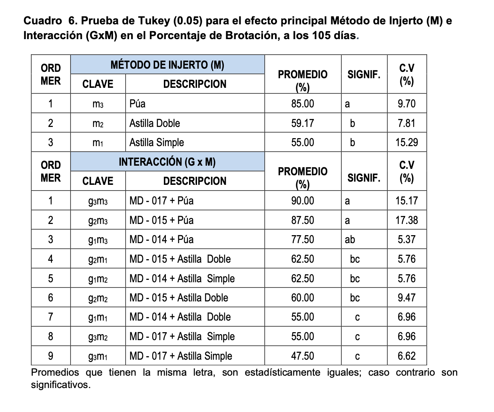
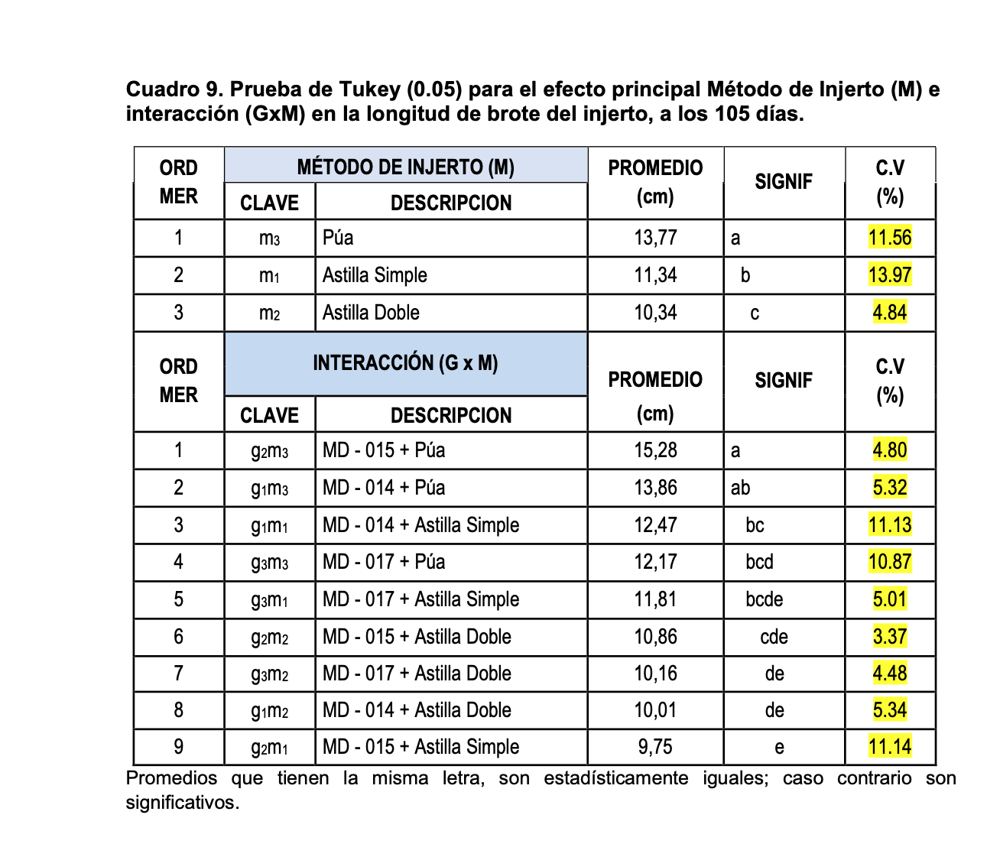
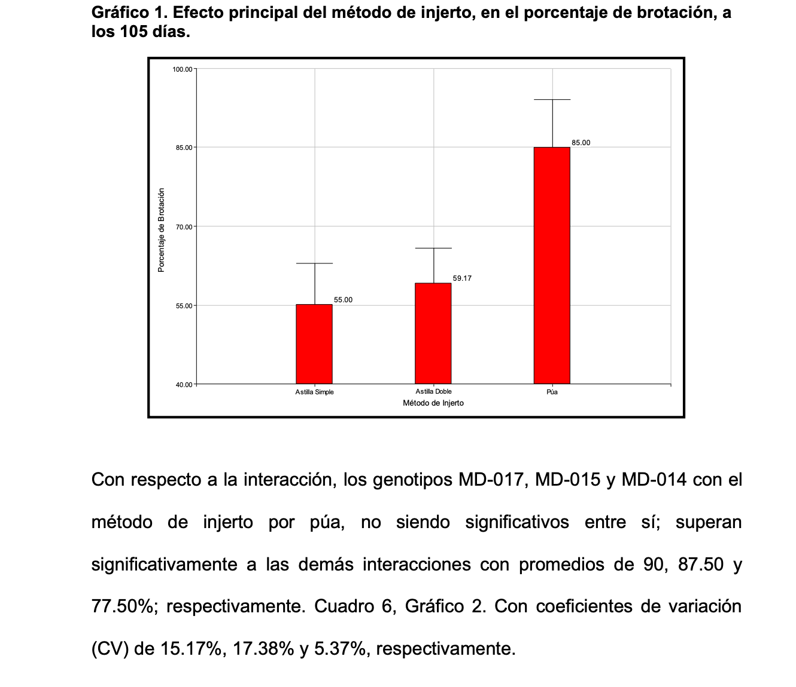
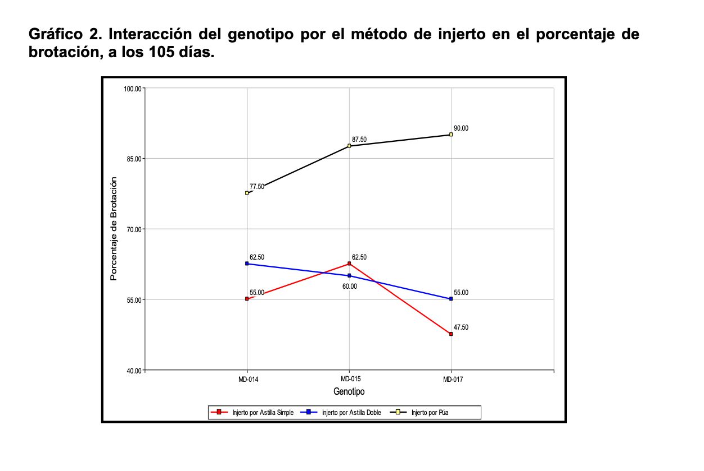

```{r}
#| label: setup
#| include: false
library(dplyr)
library(ggplot2)
library(emmeans)
library(multcomp)

datos <- read.csv("data/camu_camu_injertos.csv") |>
  mutate(
    bloque   = factor(bloque),
    genotipo = factor(genotipo),
    metodo   = factor(metodo, levels = c("astilla_simple", "astilla_doble", "pua"))
  )
```

## 1. La base de datos

| Aspecto | En la tesis | En nuestra base |
|---|---|---|
| Formato | 4 tablas cruzadas, una por variable | Una tabla: una fila por parcela |
| Identificación | Sin código de parcela | Columna `parcela` (101 a 409) |
| Factores | Códigos g1, m1, T1 | Nombres reales: MD-014, pua |
| Totales | Mezclados con los datos | Se calculan en R |
| Brotación | Solo el porcentaje | Plantas brotadas de 10 injertadas |
| Transformaciones | Guardadas como columnas | Se hacen en el código |
| Nombres de columna | Con espacios, símbolos y coma decimal | Sin tildes ni símbolos, punto decimal |

## 2. El análisis

| Variable | Tesis | Nuestro reanálisis | ¿Cambia la conclusión? |
|---|---|---|---|
| % de brotación | Arcoseno + ANOVA: interacción G × M significativa (p = 0.014) | GLM binomial: interacción no significativa (p = 0.43) | **Sí** |
| Nº de brotes | Raíz + ANOVA: método significativo | No analizable: varianza cero en dos métodos | **Sí** |
| Longitud de brote | ANOVA: interacción G × M significativa | ANOVA con supuestos verificados: se confirma (p < 0.001) | No |
| Hojas por brote | Raíz + ANOVA | No la reanalizamos | — |

## 3. Cuadro por cuadro

### Brotación (Cuadro 6)

::: {layout-ncol=2}


```{r}
m_bin <- glm(
  cbind(plantas_brotadas, plantas_injertadas - plantas_brotadas) ~ bloque + metodo,
  family = binomial, data = datos
)
cld(emmeans(m_bin, ~ metodo, type = "response"),
    Letters = letters, adjust = "tukey", reversed = TRUE) |>
  as.data.frame() |>
  transmute(Método = metodo,
            `Brotación (%)` = round(100 * prob, 1),
            `IC 95 %` = paste0(round(100 * asymp.LCL, 1), "–", round(100 * asymp.UCL, 1)),
            Grupo = trimws(.group)) |>
  knitr::kable(row.names = FALSE)
```
:::

Los dos análisis coinciden en que la púa es superior y en que las astillas no difieren entre sí. La diferencia es que la tesis además presenta una tabla de interacción genotipo × método, que con el modelo adecuado no corresponde, porque esa interacción no es significativa.

### Longitud de brote (Cuadro 9)

::: {layout-ncol=2}


```{r}
m_lon <- lm(longitud_brote_cm ~ bloque + genotipo * metodo, data = datos)
cld(emmeans(m_lon, ~ metodo), Letters = letters, adjust = "tukey", reversed = TRUE) |>
  as.data.frame() |>
  transmute(Método = metodo,
            `Longitud (cm)` = round(emmean, 2),
            Grupo = trimws(.group)) |>
  knitr::kable(row.names = FALSE)
```
:::

Aquí los resultados coinciden: los tres métodos difieren entre sí. Pero la media de astilla simple es 11.23 cm y no 11.34 como figura en el cuadro de la tesis.

## 4. Gráfico por gráfico

### Efecto del método (Gráfico 1)

::: {layout-ncol=2}


```{r}
emmeans(m_bin, ~ metodo, type = "response") |>
  as.data.frame() |>
  ggplot(aes(metodo, prob)) +
  geom_pointrange(aes(ymin = asymp.LCL, ymax = asymp.UCL)) +
  scale_y_continuous(labels = scales::percent, limits = c(0, 1)) +
  labs(x = "Método de injerto", y = "Brotación (IC 95 %)") +
  theme_classic(base_size = 13)
```
:::

El eje del gráfico de la tesis empieza en 40 %, lo que hace ver la diferencia más grande de lo que es, y sus barras de error solo van hacia arriba sin indicar qué representan. El nuestro parte de 0 % y muestra el intervalo de confianza completo.

### Interacción genotipo × método (Gráfico 2)

::: {layout-ncol=2}


```{r}
datos |>
  group_by(genotipo, metodo) |>
  summarise(b = sum(plantas_brotadas), n = sum(plantas_injertadas), .groups = "drop") |>
  mutate(p = b / n, ee = sqrt(p * (1 - p) / n)) |>
  ggplot(aes(genotipo, p, shape = metodo)) +
  geom_pointrange(aes(ymin = p - 1.96 * ee, ymax = pmin(p + 1.96 * ee, 1)),
                  position = position_dodge(0.5)) +
  scale_y_continuous(labels = scales::percent, limits = c(0, 1)) +
  labs(x = "Genotipo", y = "Brotación (IC 95 %)", shape = "Método") +
  theme_classic(base_size = 13)
```
:::

El gráfico de la tesis une los genotipos con líneas, como si fueran una secuencia, y no muestra el error. Al agregar los intervalos se ve que, para cada genotipo, las dos astillas se superponen y solo la púa se separa. Por eso no hay interacción: el efecto del método es el mismo en los tres genotipos.

## 5. Errores en el texto de la tesis

Al revisar los cuadros contra los datos del anexo encontramos:

En la tabla de interacción del Cuadro 6, la clave no coincide con la descripción en cuatro filas (m1 = astilla simple, m2 = astilla doble):

| Fila | Clave | Dice | Debería decir |
|---|---|---|---|
| 4 | g2m1 | MD-015 + Astilla Doble | MD-015 + Astilla Simple |
| 5 | g1m2 | MD-014 + Astilla Simple | MD-014 + Astilla Doble |
| 7 | g1m1 | MD-014 + Astilla Doble | MD-014 + Astilla Simple |
| 8 | g3m2 | MD-017 + Astilla Simple | MD-017 + Astilla Doble |

Además:

- En el Cuadro 9, la longitud media de astilla simple figura como 11.34 cm; con los datos del anexo es 11.23 cm, que es el valor que cita el texto.
- En el Cuadro 11, la media de hojas con púa es 11.56; con los datos es 11.52, como dicen las conclusiones.

## 6. Conclusión

La recomendación principal de la tesis se mantiene: **el injerto por púa es el mejor método** (85 % de brotación frente a 55–59 % de las astillas). Lo que no se sostiene es la interacción genotipo × método en la brotación, que aparece por usar un ANOVA sobre porcentajes de solo 10 plantas, y el análisis del número de brotes, que depende del método por construcción.

Con los datos organizados en formato tidy, todo el análisis se puede reproducir desde el código de esta página.