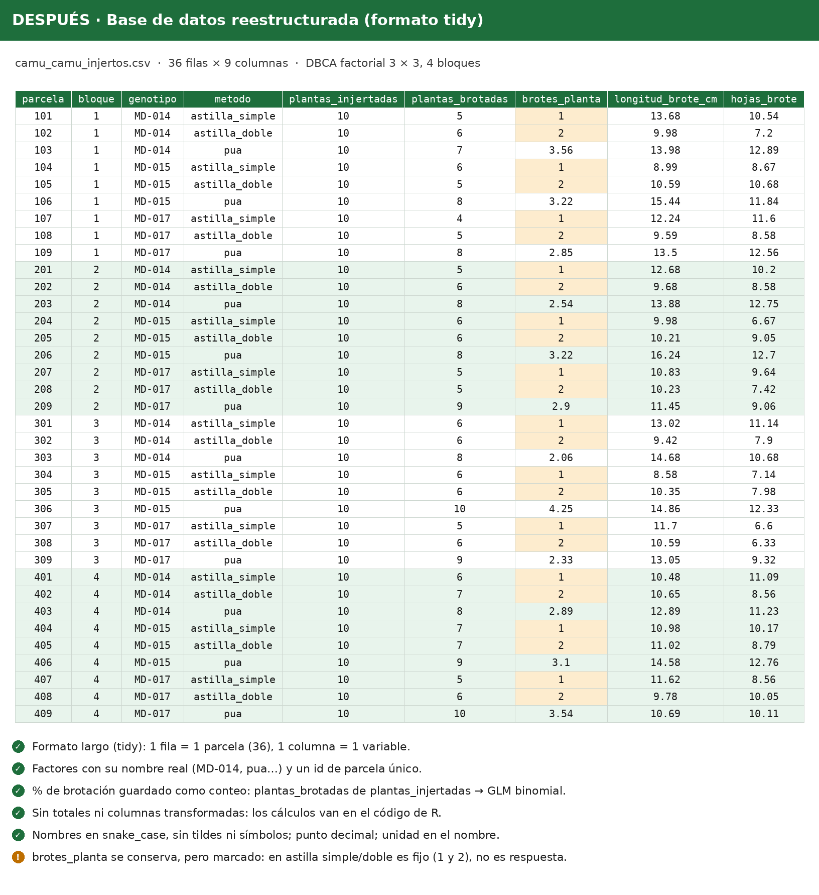

```{r}
#| label: setup
#| include: false
library(ggplot2)
library(dplyr)
library(emmeans)

azul   <- "#0B2A5B"
dorado <- "#C9A227"
gris   <- "#6B7280"
col_gen <- c("MD-014" = azul, "MD-015" = dorado, "MD-017" = gris)
```

## 1. Nuestra base de datos

Reorganizamos los datos en **formato tidy**: una fila por parcela y una columna por variable.



```{r}
datos <- read.csv("data/camu_camu_injertos.csv") |>
  mutate(
    bloque   = factor(bloque),
    genotipo = factor(genotipo),
    metodo   = factor(metodo, levels = c("astilla_simple", "astilla_doble", "pua")),
    brotacion_pct = 100 * plantas_brotadas / plantas_injertadas
  )
str(datos)
```

## 2. Porcentaje de brotación

### Su método: arcoseno + ANOVA

```{r}
datos$pct_arcoseno <- asin(sqrt(datos$brotacion_pct / 100)) * 180 / pi
anova(lm(pct_arcoseno ~ bloque + genotipo * metodo, data = datos))
```

### Nuestro método: GLM binomial

Cada parcela tiene **10 plantas**, y cada una brota o no brota. Eso es un dato **binomial**, y el modelo adecuado es un GLM binomial, no un ANOVA sobre porcentajes transformados.

```{r}
m_bin <- glm(
  cbind(plantas_brotadas, plantas_injertadas - plantas_brotadas) ~
    bloque + genotipo * metodo,
  family = binomial, data = datos
)
anova(m_bin, test = "Chisq")
```

::: {.callout-tip}
## Hallazgo
Con el GLM binomial, la interacción genotipo × método deja de ser significativa (p = 0.43; en la tesis, p = 0.014) y el efecto de bloque también desaparece. Solo el método de injerto afecta la brotación.
:::

### Comparación entre métodos

Como la interacción no es significativa, ajustamos el modelo solo con bloque y método, y comparamos los métodos entre sí.

```{r}
m_bin2 <- glm(
  cbind(plantas_brotadas, plantas_injertadas - plantas_brotadas) ~
    bloque + metodo,
  family = binomial, data = datos
)
emm <- emmeans(m_bin2, ~ metodo, type = "response")
emm
pairs(emm)
```

La púa tiene una probabilidad de brotación de 0.85, frente a 0.59 de la astilla doble y 0.55 de la astilla simple. Las dos astillas no difieren entre sí (p = 0.79).

```{r}
#| fig-cap: "Proporción de plantas brotadas por método y genotipo (± IC 95 %)."
resumen <- datos |>
  group_by(genotipo, metodo) |>
  summarise(brotadas = sum(plantas_brotadas),
            injertadas = sum(plantas_injertadas), .groups = "drop") |>
  mutate(p = brotadas / injertadas,
         ee = sqrt(p * (1 - p) / injertadas))

ggplot(resumen, aes(metodo, p, shape = genotipo)) +
  geom_pointrange(aes(ymin = p - 1.96 * ee, ymax = pmin(p + 1.96 * ee, 1)),
                  position = position_dodge(0.4)) +
  scale_y_continuous(labels = scales::percent, limits = c(0, 1)) +
  labs(x = "Método de injerto", y = "Plantas brotadas", shape = "Genotipo") +
  theme_classic(base_size = 13)
```

## 3. Longitud de brote

Aquí los datos son continuos y el ANOVA sí es adecuado. Revisamos los supuestos:

```{r}
m_lon <- lm(longitud_brote_cm ~ bloque + genotipo * metodo, data = datos)
anova(m_lon)
shapiro.test(residuals(m_lon))
```

En esta variable coincidimos con la tesis: la interacción genotipo × método sí es significativa (p < 0.001) y los residuos son normales (p = 0.99).

```{r}
#| fig-cap: "Longitud de brote por parcela; la línea une las medias de cada genotipo."
ggplot(datos, aes(metodo, longitud_brote_cm, shape = genotipo, group = genotipo)) +
  geom_point(position = position_dodge(0.4), size = 2) +
  stat_summary(fun = mean, geom = "line", position = position_dodge(0.4)) +
  labs(x = "Método de injerto", y = "Longitud de brote (cm)", shape = "Genotipo") +
  theme_classic(base_size = 13)
```

## 4. Número de brotes

```{r}
tapply(datos$brotes_planta, datos$metodo, var)
```

En astilla simple y astilla doble la varianza es **cero**: siempre hay 1 y 2 brotes, porque cada astilla lleva 1 o 2 yemas. El número de brotes lo fija el método, no es un resultado del experimento, así que no corresponde analizarlo con ANOVA como hizo la tesis.